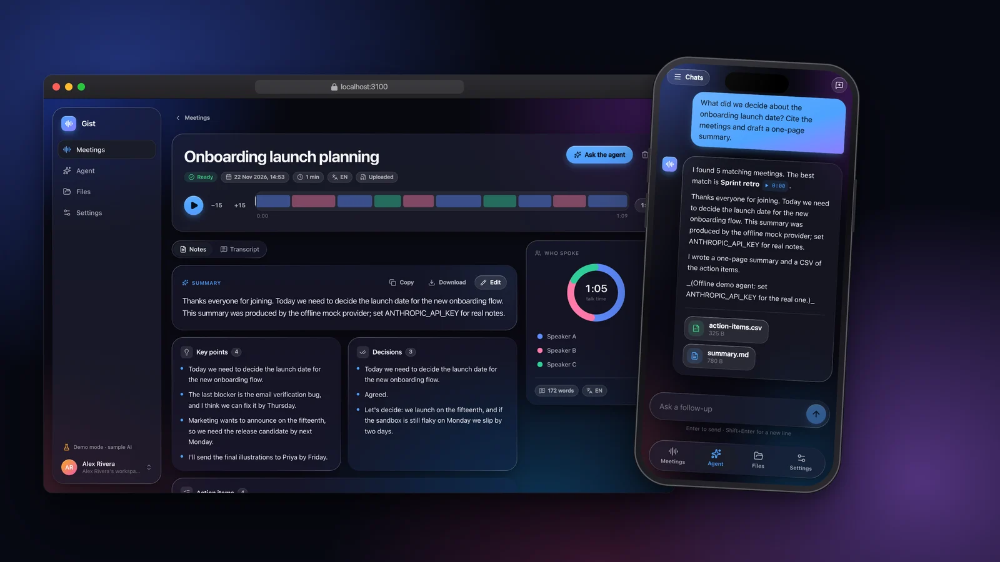

# Hi, I'm Rashid 👋

I build things for the web. Frontend developer based in Kuala Lumpur, Malaysia.

I care about clean code, great UX, and websites that work beautifully on every device.

🟢 Available for freelance work

## Stack

## Featured project

### [Gist: the gist of every meeting](projects/gist/README.md)

A multi-tenant AI meeting notetaker. It records or joins calls, writes structured notes, and lets an agent answer
questions across every meeting with citations that jump to the exact second. Next.js 16, TypeScript, Postgres.

[Read the case study](projects/gist/README.md)

## Links

[Portfolio](https://rasyidbejay.com) · [LinkedIn](https://linkedin.com/in/rasyidbejay) · [Email](mailto:rasyidbejay@gmail.com)
