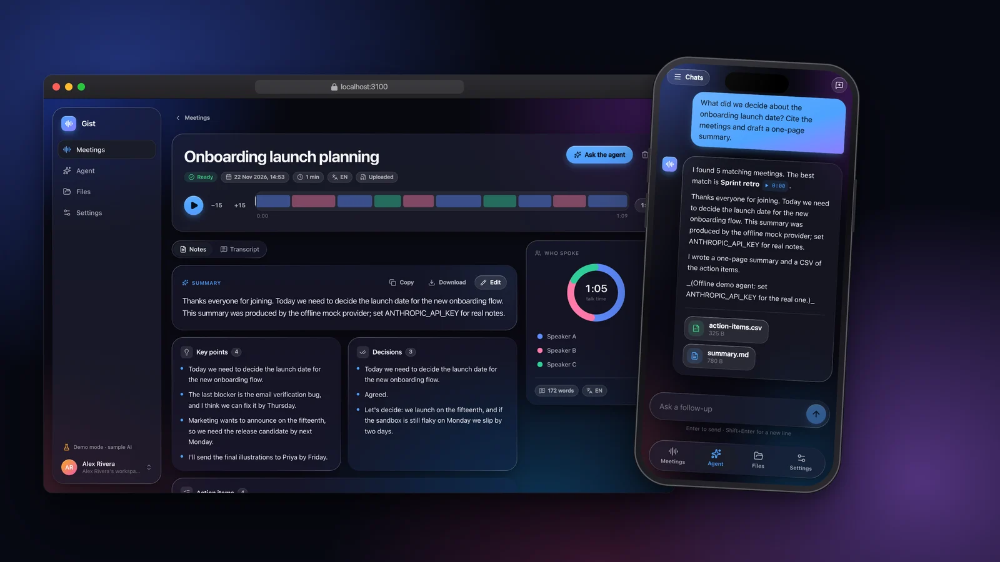
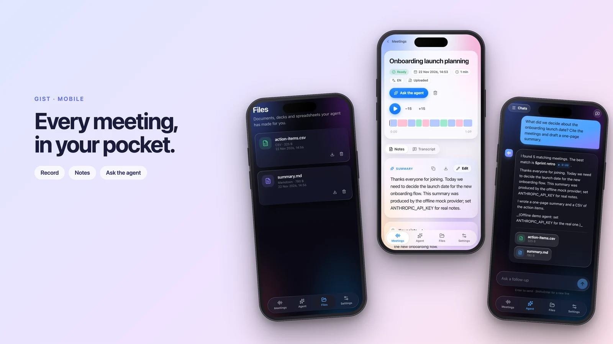
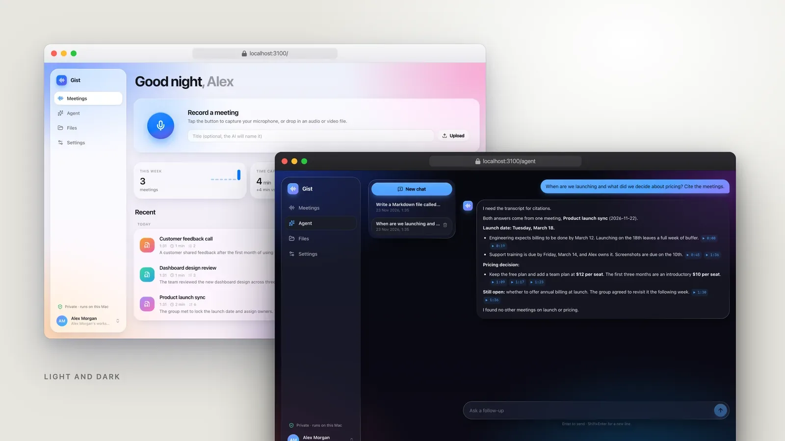
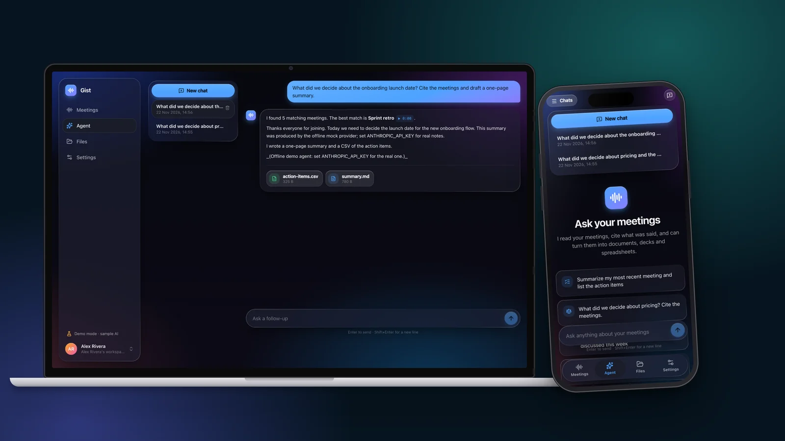
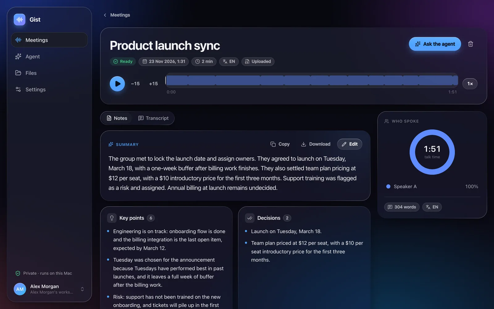
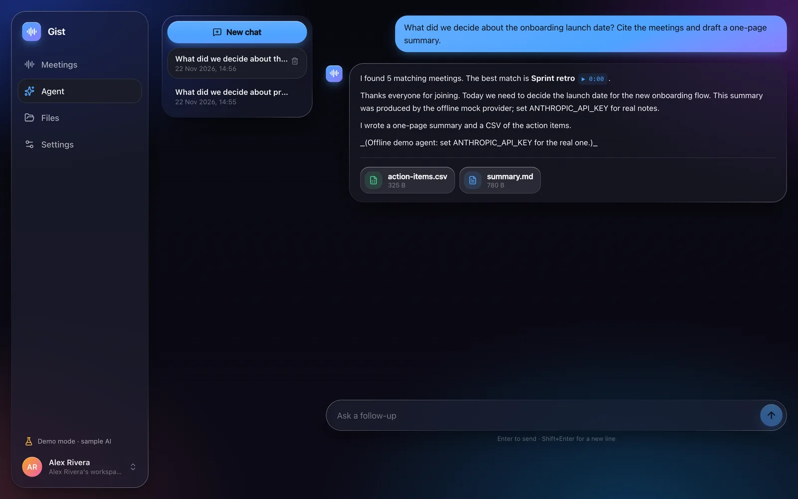
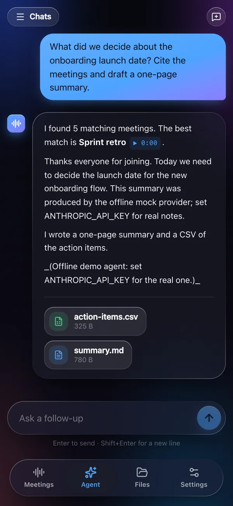
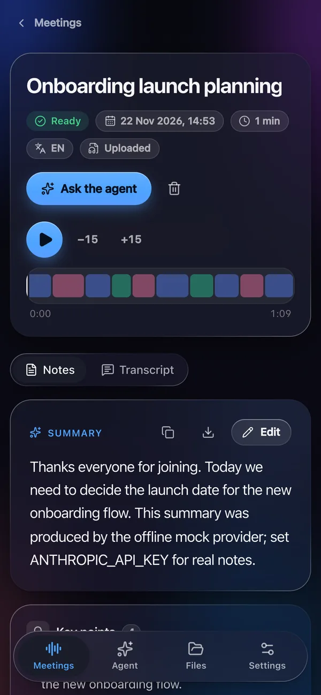

# Gist: case study

> **The gist of every meeting.** A meeting notetaker that records or joins your calls, writes the notes, and lets
> an AI agent answer questions across all your meetings and turn them into documents, decks and spreadsheets.

**Role:** solo design and full-stack build. **Stack:** Next.js 16, React 19, TypeScript, Tailwind CSS 4, Postgres
(embedded PGlite or real `pg`), zod, Anthropic (Claude and Managed Agents), Whisper, AssemblyAI, Recall.ai, Google
Calendar OAuth, S3-compatible storage, Chrome Extension (Manifest V3).
**Size:** about 10,700 lines of TypeScript/TSX in `src/`, 39 API routes, 21 UI components, plus about 960 lines of
test scripts.









<details>
<summary>Plain screenshots</summary>





<p>
  
  
</p>

</details>

*Screenshots come from a throwaway demo account. The meetings are synthetic spoken audio; the transcripts, notes and agent answers are real output from local Whisper and Claude.*

---

## 1. The problem

Meetings produce decisions and action items that live only in people's heads. Notetaker tools exist, but most are
cloud-only, send your audio to a vendor you can't swap, and stop at a summary. I wanted one that:

1. captures a meeting however it happens (browser, file, live call, or a browser extension),
2. gives structured notes, not a wall of text,
3. lets you **ask questions across every meeting** with answers you can verify, and
4. can run **free and local** (Whisper plus your own Claude login) or on cloud services, from one codebase.

## 2. What it does

| Area | Details |
|---|---|
| **Capture** | Record in the browser; upload audio/video; send a bot into a live Zoom / Google Meet / Teams call by link; auto-join from a connected calendar; record a meeting tab and microphone with the Chrome extension |
| **Notes** | Speaker-labelled, searchable transcript; summary, key points, decisions, action items (with owner and due date when stated), open questions; editable; copy and download |
| **Playback** | Audio player with a speaker timeline, skip back/forward 15 s, playback speed, and click-to-seek from any citation |
| **Insights** | Dashboard with meetings this week, time captured, action-item counts, and a who-spoke breakdown per meeting |
| **Agent** | Chat that reads your meetings through scoped tools, cites transcript lines as chips that open the meeting at that second, and writes Markdown, CSV, PDF, DOCX, XLSX and PPTX files into a shared Files hub |
| **Workspaces** | Owners and members, single-use invite links, switch between workspaces, personal calendars |
| **Files hub** | Everything the agent makes, previewed in place (Markdown, text, CSV, JSON, images, PDF) or downloaded (Office files) |
| **Settings** | Workspace, members, invites, capture tokens for the extension, password change |

## 3. Highlights worth showing off

### 3.1 One pipeline, swappable providers
Transcription, summarising, the agent and the call bot are each an interface with a **mock**, a **cloud** and (where
it makes sense) a **local** implementation, chosen by environment variables. Consequences:

- The whole app runs with **no API keys** on offline mocks, an embedded Postgres and local disk. That is how the demo
  screenshots were made, and it makes the test suite deterministic and free.
- **Free single-user mode:** Whisper on your machine plus the Claude Code CLI signed in with your own account.
- **Cloud mode:** AssemblyAI (speaker labels, language detection), Anthropic (notes, agent), Recall.ai (bots).

### 3.2 A contained local agent
The local agent runs on Claude Code with its own shell, file-edit and web tools **switched off**, along with your
settings, hooks, plugins, skills and MCP servers, in an empty folder, with `ANTHROPIC_API_KEY` removed from its
environment. Its only tools come from the app over a **per-run, unguessable MCP URL** that is revoked when the run
ends: read-only meeting tools (scoped to the workspace) and file makers that can only write into that chat's output
folder. There is no tool that can join a call, so nothing needs approval. A meeting that says "ignore your
instructions" can at worst make the agent read that workspace's meetings and write files into its folder.

### 3.3 Grounded, cited answers
The agent reads meetings through four tools: `meetings_search`, `meetings_get`, `meetings_transcript` and
`meetings_transcript_search`. Transcript lines carry citation tokens, and the UI turns them into ▶ chips that open
the meeting **at that second**. Retrieval is Postgres full-text search plus the model's own query refinement.

### 3.4 Tenant isolation as a first-class feature
Every table with user data carries a `workspace_id`. The data layer has two halves: workspace-scoped functions for
request handlers (each query has `AND workspace_id = $n`, so another workspace's id is simply "not found"), and
separate `…Any` functions used only by the background worker. The agent's tools run **on the server**, and the
workspace comes from the run record, never from the model's input, so an id the model invents (or is talked into
by text in a transcript) returns "Not found". A regression suite of **83 checks** signs up throw-away users and
attacks every route across workspaces and with forged, cross-origin and hostile input.

### 3.5 A durable job queue in Postgres
Work (transcription, notes, bot polling, agent runs) goes through a `jobs` table with retries, backoff, dedupe keys
and self-rescheduling polls. Jobs are claimed with `FOR UPDATE SKIP LOCKED`, so several instances can share one
database. Agent runs have their own concurrency lane so long runs can't starve transcription. Booking a bot (meeting
row, calendar claim and job) is one transaction, so it can't be half-done or duplicated.

### 3.6 Re-entrant agent runs
After an approval pause, a deploy or a crash, the run driver reclaims the run by heartbeat, replays the session
events from where the run began, and never repeats a side effect: a tool that already executed is re-sent from its
stored result, never re-run.

### 3.7 Human in the loop and cost control
Sending a recording bot into a live call always pauses for a person; the approval card shows exactly what will
happen. Each chat has a hard dollar cap, a time limit and a tool-call limit per run, a daily run cap per workspace,
a Stop button, and one active run per chat.

### 3.8 A Chrome extension that labels speakers without a speaker model
The extension (Manifest V3, offscreen document for capture) records a meeting tab plus the microphone as **stereo**:
left channel is the call, right channel is you. Whisper transcribes each channel on its own, so the transcript
labels **Others** vs **you** with no speaker-recognition model. Silence and room noise on a channel are dropped
(Whisper invents words there), and the microphone's echo of the call is removed. Audio is saved to disk every 5
seconds, so a browser crash or an app that is down loses nothing; unsent recordings wait in the popup. Its **capture
token** can only add recordings, and is stored hashed.

### 3.9 Authentication and access, built by hand
- Passwords: scrypt (N=32768), 10+ characters; changing it signs out every other device.
- Sessions: random 256-bit token in an `HttpOnly; SameSite=Lax` cookie (`Secure` over HTTPS); only its SHA-256 is
  stored, so logout and removal revoke server-side; 30 days, sliding.
- Sign-in is throttled per account and per IP; a wrong email and a wrong password look identical.
- CSRF: `SameSite=Lax` plus an `Origin` check on every cookie-authenticated write.
- Sign-up is closed after the first account; owners invite people with a single-use link (valid 7 days, shown once,
  only its hash is stored).
- `src/proxy.ts` redirects page requests without a cookie to `/login`, but it is only a convenience: **every API
  route authorises on its own**.

### 3.10 Untrusted files, handled as untrusted
Anything the agent writes can contain whatever the model was steered into. The file route allow-lists a few inert
types for inline display; HTML, SVG, Office files and anything unknown are forced to download as `octet-stream`;
every response has `nosniff` and a CSP `sandbox`; file names are reduced to a clean base name; the storage key never
leaves the server. The Markdown preview is a safe renderer.

### 3.11 Design
Frosted "liquid glass" panels over a soft aurora background, light and dark themes, a sidebar on desktop and a
floating bottom tab bar on mobile, skeleton loading, and fallbacks for **reduced transparency, reduced motion and
high contrast**. Design tokens and the glass, button and field classes live in one stylesheet; shared pieces (rings,
spark bars, avatars, segmented control) live in one UI module; the app's name lives in one file.

## 4. Architecture

```
Browser / Chrome extension
        |  (cookie session, or capture token that can only upload)
        v
Next.js 16 App Router (UI + 39 route handlers)       src/proxy.ts = optimistic page gate
        |
        +-- src/lib/auth/        password, sessions, invites, throttle, guard
        +-- src/lib/db.ts        meetings and transcripts: workspace-scoped + worker-only functions
        +-- src/lib/sql.ts       Postgres via `pg` or embedded PGlite behind one interface; versioned migrations
        +-- src/lib/storage.ts   local disk or S3-compatible object store
        +-- src/lib/queue.ts, worker.ts, jobs.ts   durable queue (SKIP LOCKED), loop, handlers
        |        started in-process by src/instrumentation.ts
        +-- src/lib/pipeline.ts  transcribe -> summarise
        +-- src/lib/providers/   transcribe / summarize / bot: mock + real, chosen by env
        +-- src/lib/calendar/    Google OAuth (PKCE), sync, demo calendar
        +-- src/lib/agent/       vendor-neutral event types, store, scoped tools, run driver,
                                 service (limits, approvals), Managed Agents, Claude Code, mock
```

Data flow for a recording: upload (streamed to storage) -> `process_meeting` job -> transcribe -> summarise ->
notes validated against a schema (zod) -> meeting marked ready. A bot meeting adds a polling job that follows the
bot's status until the call ends and the recording is fetched.

## 5. Technical decisions and trade-offs

| Decision | Why | Cost |
|---|---|---|
| Postgres as the queue | One less moving part; transactional bot booking; `SKIP LOCKED` scales to a few instances | Not for huge throughput |
| Embedded PGlite by default | Zero-setup local use and a hermetic test database | One process only; switch to `DATABASE_URL` for more |
| Tools run on the server, not in the agent's sandbox | The model can never choose the workspace; no credentials in the sandbox | The server does the reads |
| Mock providers as first-class code | Deterministic tests, free demos, no keys to run | Mock content is canned |
| Long-running Node server, not serverless | Uploads stream through it and the worker runs in-process | Deploy to Fly, Railway or a VPS, not Vercel |
| No embeddings (Postgres full-text search only) | Simple and explainable | Conceptually related meetings with different words can be missed |
| Own auth instead of a hosted provider | Full control of revocation, throttling and isolation, and a learning goal | No password reset, MFA or SSO yet |

## 6. Testing and verification

- **83 automated checks** (`npm run test:isolation`): auth, tenant isolation and the agent, including a simulated
  hostile model asked to read another workspace's meeting. It refuses to run against real AI providers.
- Roughly 240 earlier shell-script checks across phases (throttling, invites, roles, bots, calendar, restarts, queue,
  S3, the `pg` driver).
- **47 checks** for the local Claude Code agent against a fake `claude` binary: tools over MCP, isolation flags,
  session resume, real `.xlsx`/`.docx`/`.pptx` output, cancel kills the process, path traversal and unknown tools
  unreachable, revoked tokens give 404.
- **26 end-to-end checks** for the extension in real Chrome with real Whisper, plus **35** for its server side.
- Whisper verified on a short spoken sample; real `claude -p` verified once end to end (Whisper -> Claude notes ->
  agent).

### Honest limits (put these under "what's next")
- The real **Anthropic Managed Agents** provider is written against the docs and type-checked but has **never been
  run against the live API**.
- The extension's `chrome.tabCapture` on a real meeting is **not** verified (Chrome only allows it after a genuine
  toolbar click, so it can't be automated). Edge/Brave/Arc and long recordings are untested.
- Local Whisper has no speaker recognition; several other people all appear as "Others".
- No password reset, email, MFA or SSO; no audit log; no ownership transfer.
- No semantic search; the agent can't edit or delete meetings or accept your own documents yet.
- Google Calendar only (no Outlook).
- Recording a meeting needs consent from participants; the app tells users to say so.

## 7. What I would build next
1. Run the Managed Agents provider once with a small budget and verify its event ordering and cost units.
2. Embeddings-based search alongside full-text.
3. Real speaker diarisation in local mode.
4. Password reset by email, MFA, and an audit log.
5. Outlook calendar, ownership transfer, and sharing links for files.

## 8. What this project demonstrates
Full-stack TypeScript with the latest Next.js and React; secure multi-tenant design; building on LLM APIs with
tool use, approvals, cost control and prompt-injection mitigation; background-job architecture with durable,
re-entrant workflows; browser extension development; and test strategy that includes adversarial cases.
